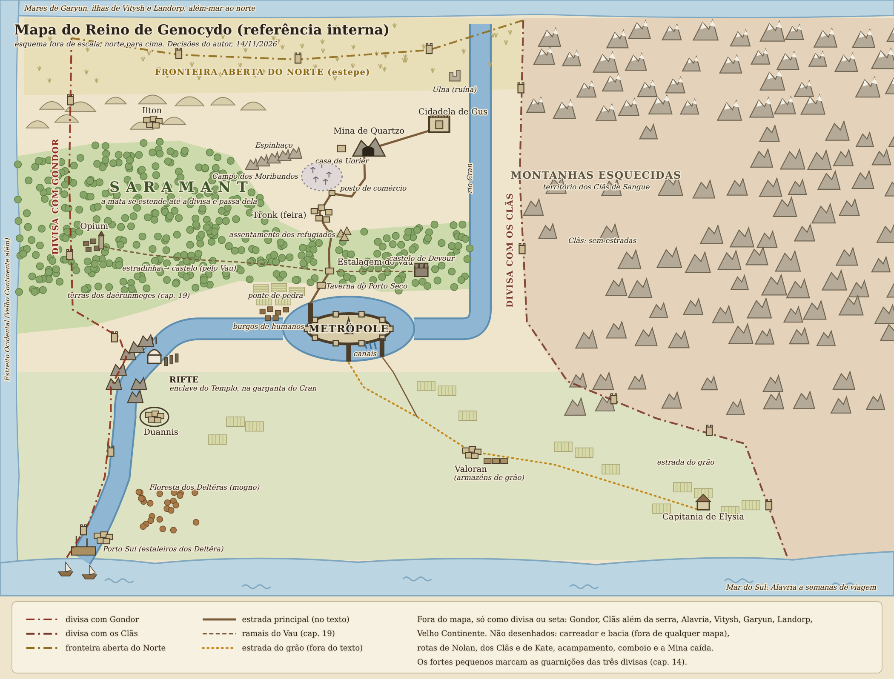
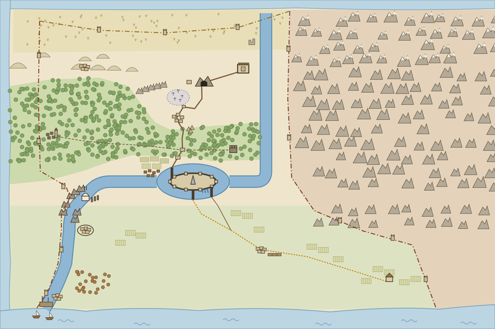

# Mapa do Reino de Genocydo

Esquema fora de escala, norte para cima. Decisões do autor de 2026-11-14 (ver `decisoes/2026-11-14-mapa-do-reino-lugares-e-divisas.md`).



Arquivos editáveis: `mapa-do-reino-referencia.svg` (com rótulos) e `mapa-do-reino-guia.svg` (guia limpo, sem texto, para usar como referência numa IA de imagem).



## Versões

- **Referência interna:** com rótulos. Serve de posição geográfica para qualquer texto do Reino.
- **Guia de composição:** sem texto, sem rotas e sem spoilers. É a imagem que vai junto do prompt.
- **Versão do livro (ilustrada):** gerada a partir do guia. Mostra o mundo antes dos eventos: a Mina e o castelo de Devour aparecem inteiros; não aparecem rotas, acampamento dos Clãs, comboio nem o carreador.

## O que está no mapa

| Lugar | Fonte | Situação |
|---|---|---|
| Metrópole, ilha com dois braços do Cran, ponte de pedra, burgos de humanos fora da muralha | caps. 17, 46, 47 | no texto e decisão de 2026-11-14 (`lugares/metropole.md`) |
| Taverna do Porto Seco | cap. 17 | no texto; fica na estrada de Saramant, a horas da ponte e depois dos campos (parada no fim da tarde); não está entre os burgos |
| Saramant, a grande mata, do Vau e do castelo de Devour até a divisa com Gondor, e além | caps. 5, 17, 19 | no texto; extensão decidida (`lugares/saramant.md`) |
| Estalagem do Vau e os três ramais | cap. 19 | no texto |
| Castelo de Devour (leste do Vau) | caps. 13, 19 | no texto |
| Opium, na ponta oeste do ramal oeste | caps. 5 e 13 | decisão do autor (`lugares/opium.md`) |
| Terras dos daërunmeges, dentro da mata do oeste | cap. 19 | no texto ("a região dos lobisomens"); posição decidida |
| Assentamento dos refugiados, Tronk, posto de comércio | caps. 23 a 28 | no texto |
| Campo dos Moribundos, com a estrada fazendo a volta | cap. 32 | no texto; entra no mapa por decisão do autor |
| Espinhaço, na Subida | caps. 28 e 33 | no texto; fora da rota Gus–Metrópole |
| Mina de Quartzo, casa de Uorier | caps. 33 e 40 | no texto |
| Cidadela de Gus, estepe e fronteira aberta ao norte | ficha de Gus, epílogo | no texto |
| Montanhas Esquecidas (Clãs de Sangue) | ficha dos Clãs | decisão: a leste do Cran, de norte a sudeste |
| Rifte, enclave do Templo, na garganta do baixo Cran | caps. 10, 28, 33, 40, 57 | decisão do autor (`lugares/rifte.md`) |
| Duannis, Valoran, Ilton | cap. 17 | posições decididas (`lugares/duannis.md`, `valoran.md`, `ilton.md`) |
| Porto Sul, estaleiros e floresta de mogno dos Deltëra | caps. 7, 47, 49, 64 | decisão do autor (`lugares/porto-sul.md`) |
| Capitania de Elysia e a estrada do grão | caps. 47 e 58 | decisão do autor (`personagens/elysia.md`) |
| Ulna (ruína), no alto Cran | timeline | decisão do autor |

## Estradas

- **Estrada principal:** ponte de pedra, campos, Porto Seco, Vau, assentamento, Tronk, posto de comércio, Subida (a estrada faz a volta larga em torno dos Moribundos), Mina, garganta norte, Gus.
- **Ramais do Vau (cap. 19):** norte para a Mina; leste para o castelo de Devour; oeste para a região dos lobisomens. A estradinha de Opium (cap. 5) é o ramal oeste: atravessa a mata, passa pelo Vau e vira o ramal leste.
- **Mina a Gus:** trilha estreita de pedestre pela garganta norte (caps. 38 e 40) e "rota secundária" de carruagem, que contorna os desfiladeiros; arraial de cocheiros fora do fosso seco de Gus (cap. 40).
- **Estrada do grão** (fora do texto): da Capitania de Elysia, pelo pé da serra e por Valoran, ao Portão Sul.
- **Não entram:** o carreador e a bacia de pedra ("fora de qualquer mapa", `lugares/subida-da-mina.md`); a trilha do Espinhaço como estrada; rotas de Nolan, dos Clãs e de Kate.

## Divisas e fronteiras

- **Oeste, Gondor** (cap. 17: "fronteira do oeste"): atravessa a mata dos daërunmeges e desce pela margem oeste do baixo Cran até a costa. A mata passa da divisa.
- **Leste, Clãs de Sangue** (cap. 14: "a divisa com os Clãs de Sangue"): corre ao pé da serra, do Cran até a costa sudeste.
- **Norte:** fronteira aberta de estepe (epílogo; Gus é o último posto).
- **Sul:** a costa; Alavria vem por mar, pelo Porto Sul.
- **Guarnições:** pequenos fortes nas três linhas (cap. 14: "patrulhas das fronteiras").

## Fora do mapa, só como divisa ou seta

Gondor (oeste); Clãs além da serra (leste); Alavria, a semanas pelo mar (sul), com Sucontinente e Arquipélago do Fogo; Garyun, Vitysh e Landorp, além-mar ao norte; Velho Continente (Vikindar e Bos-Bosnya), além do estreito ocidental. Ver `lugares/landorp.md`.

## Pontos de L2 que dependem de posição

Anotar só na referência interna, não no mapa do livro: o monte do veterano (território gondoriano, `lugares/gondor.md`) e o monte que Lakand reconhece como sagrado; o desembarque da segunda onda de Alavria (Porto Sul ou costa sul, `decisoes/2026-11-12-logistica-alavria.md`); o refém Joachin em Alavria; a rota da Hoste de Hícse até a Metrópole.

## Prompt final para a versão ilustrada

Use o guia (`mapa-do-reino-guia.png`) como imagem de referência de estrutura (image prompt, structure reference ou ControlNet) e gere **sem texto**; os nomes entram depois, em camada separada.

```
Antique fantasy atlas map of an entire realm, drawn as an aged engraved plate: warm parchment, brown-black iron-gall ink linework, fine cross-hatching and stippling, muted watercolor washes (desaturated ochre, slate-blue water, moss green, dry-grass yellow, soft rust-brown for the eastern mountains), light foxing and edge wear, a double-rule decorative border with small corner ornaments, an empty cartouche for the title in the lower-left sea, a small compass rose in the upper-right. Solemn, severe mood, Reformation-era woodcut and copperplate aesthetic, no whimsy, no cartoon style. Oblique bird's-eye view, 3:2 landscape, very high detail, strong value contrast so it also reads in grayscale. North is up.

Follow the attached layout exactly (positions of the river, island city, forest, mountains, roads, towns, border lines and coastlines).

WATER. A wide river rises in the far north (a small ruined tower near its source) and runs south along the centre-right of the map. At the lower centre it bends sharply and runs west; at the bend it splits into two arms around a large oval island. West of the island it narrows into a deep rocky gorge, then turns south-west and runs to the southern sea. Blank sea along the whole southern edge, a narrow strait down the western edge and a narrow sea along the northern edge, with only a few wave marks.

THE ISLAND CITY (centre-bottom). A great fortified city of pale grey granite and whitewashed limestone: tall curtain walls with ten gate towers, stepped rooftops in two levels (a lower working quarter and a higher quarter with a castle of pale bluish quartz), and at the centre one colossal faceted milky-quartz monolith, dull and lifeless, not glowing. Two stone bridges reach the north bank and two reach the south bank. A few small dye-works canals open on the south-east waterfront. Outside the walls on the north bank: a cluster of poor unwalled mud-brick hamlets, a small road tavern, plowed fields and a few rural estates that thin out going north.

THE GREAT FOREST AND THE NORTH ROAD. A road runs north from the bridge through the fields into a vast dark forest of black oaks that spreads far to the west over rolling wooded hills, past the western border line, and thins out into the land beyond it. At the forest's southern edge a small fortified wayside inn stands at a three-way fork. The east branch is a narrow road through the forest to a dark fortress on a wooded hill (palisade of interlaced logs and hardened resin around its base, a dark stone main tower). The west branch is a long narrow track that runs through the forest to a small frontier village with a watchtower in a clearing close to the western border line (wolf-folk country, no towns). The north branch leaves the forest past a camp of tents at a bluff, reaches a small market town at a crossroads, then a roadside trading post, and climbs a dry rocky valley of reddish scrubland and loose stone beside a ridge of bare rock. The road loops wide around a misty hollow marked with faint ghostly traces (an old haunted battlefield), then reaches a large intact quartz mine (rugged grey rock massif with iron gates, sorting ramps, dark gallery mouths and timber scaffolding) with a manor house on the slope above it. From the mine the road runs through a narrow mountain pass to a walled frontier citadel of pale stone beside the river, with workshops, a stake palisade, a dry moat at its southern entrance and a large academy with four domed corner towers.

NORTH. North of the forest, a plateau of low bare hills with one small town at its edge, then open windswept steppe of dry grass reaching the northern edge.

DOWNSTREAM AND SOUTH-WEST. In the gorge west of the city: a white-domed temple on the cliff above the rapids, with a row of foundry chimneys along the water. Further down, a walled river town on the east bank; a forest of reddish mahogany trees; and at the river mouth a harbour town with shipyards, a long quay, a few foundry chimneys and a few small merchant ships.

SOUTH PLAIN. A broad open plain of farmland, fields and hedgerows south of the city, with a grain-warehouse town (a row of long warehouses) and a road running south-east across the plain to a manor estate among fields in the far south-east.

EAST. A continuous belt of harsh, forbidding jagged mountains, snow-capped in the north, runs from the far north down the east side of the river and sweeps south-east along the plain, with no roads or settlements.

BORDERS. Three dash-dot border lines in muted rust and ochre: along the western edge, cutting through the forest and then down the west bank of the lower river to the coast; along the foot of the eastern mountains from the river to the south-east coast; and across the northern steppe. Small stone watchtower forts stand along all three lines. Leave the land beyond the lines as blank parchment.

ORNAMENT. Two small muted-blue twin moons in the upper-left corner, one slightly larger.

Absolutely no text, letters, numbers, labels, banners or legend anywhere (names will be added later as a separate layer). No people, no monsters, no fire, no armies, no military camps, no battle scenes, no modern elements.
```

**Negativo** (se a ferramenta tiver):

```
text, letters, numbers, signature, watermark, logo, legend, caption, photo, 3D render, cartoon, anime, people, dragons, monsters, fire, smoke, armies, battle, neon, oversaturated colors, glossy, plastic
```

**Versão curta**, para limites de caracteres:

```
Antique engraved fantasy atlas map, aged parchment, brown-black ink linework, fine hatching, muted washes, double-rule border, compass rose, no text. North up. River from the north down the right side, bending west and splitting around an oval fortified island city of pale stone with a crystal monolith; vast dark forest spreading west past a dash-dot border line, with a three-way fork inn, a dark hill fortress and a frontier village; market town, rocky mine and frontier citadel by the river; steppe and a plateau town to the north; jagged mountain belt east of the river; gorge with white temple and foundries downstream, walled river town, harbour town at the river mouth; farmland and warehouse town south; border forts; two small blue twin moons in a corner. --ar 3:2 --no text, letters, people, armies, fire
```

## Rótulos para a camada de texto

Serifa clássica (Cormorant Garamond, EB Garamond ou IM Fell), caixa-alta espaçada nos grandes e itálico nos pequenos.

- **Grandes:** METRÓPOLE, SARAMANT, MONTANHAS ESQUECIDAS.
- **Médios:** Rio Cran, Cidadela de Gus, Mina de Quartzo, Rifte, Porto Sul, Planície Sul, Capitania de Elysia, Terras dos Daërunmeges.
- **Pequenos, em itálico:** Tronk, Campo dos Moribundos, A Subida, Castelo de Devour, Estalagem do Vau, Opium, Ponte de Pedra, Valoran, Duannis, Ilton, Ulna, Floresta dos Deltëras. Só na referência: Taverna do Porto Seco, casa de Uorier, posto de comércio, assentamento dos refugiados.
- **Divisas, em caixa-alta pequena, ao longo das linhas:** Divisa com Gondor, Divisa com os Clãs, Fronteira aberta do Norte.
- **Margens:** "Mares de Garyun, ilhas de Vitysh e Landorp, além-mar"; "Estreito Ocidental (Velho Continente além)"; "Mar do Sul (Alavria, a semanas de viagem)".

## Conexões

- [Metrópole](metropole.md): a ilha, os portões e a ponte.
- [Saramant](saramant.md): a grande mata do oeste.
- [Rifte](rifte.md): o enclave do Templo na garganta do Cran.
- [Gondor](gondor.md): a divisa do oeste.
- [Clãs de Sangue](../conceitos/clas-de-sangue.md): a serra e a divisa leste.
- [A Subida](subida-da-mina.md): a estrada da Mina e os Moribundos.
