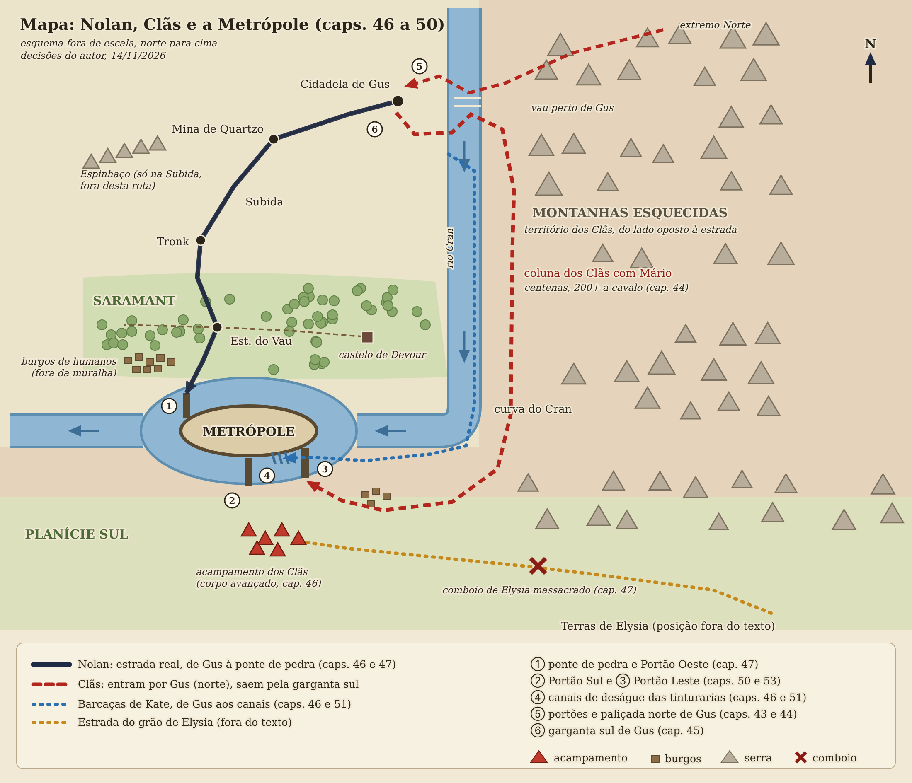

# Metrópole

A Metrópole é a capital do Reino de Genocydo, centro do poder político e
religioso da civilização leviantar. É cercada por muralhas imponentes e
dominada pelo **Monólito da Verdade**, o oráculo de Vonos que sustenta a
ordem do reino.

## Geografia

A Metrópole ocupa uma ilha onde o rio Cran se abre em dois braços, um de cada
lado da cidade, e volta a se juntar adiante (desenho do autor, 2026-11-14). O
Cran desce do norte e, na curva, passa a correr para oeste. A ponte de pedra
do cap. 17 cruza o braço do lado de Saramant; o outro braço dá na planície
sul. Não há vau perto da cidade (cap. 46). A muralha voltada
para o rio chega a doze braças de altura; no flanco sudeste, canais de
deságue das tinturarias passam sob uma arcada. A cidade é dividida em dois
níveis pelo **Muro Interno**: na parte alta, o Castelo de Quartzo e a Praça
Central; na baixa, os bairros de trabalho e dívida, onde vive o povo comum.
O muro materializa a divisão de castas: um lado concentra dignidade e poder,
o outro concentra quem paga por eles.

### Mapa e rotas (caps. 17, 46, 48, 50 e 51; decisões do autor de 2026-11-14)

O arquivo editável é `mapa-cran-metropole.svg`. O esquema é fora de escala, com o norte para cima. A legenda do mapa foi feita antes da troca dos caps. 47 e 48: onde ela diz "cap. 47" (a chegada de Nolan), leia "cap. 48".

- **Corrente:** norte para sul e, na curva, para oeste. Por isso a "margem esquerda" do cap. 46 é a margem leste/sul (a dos Clãs), e no cap. 51 a barcaça de Kate chega do leste e vê as muralhas "a oeste". Os canais de deságue das tinturarias ficam no sudeste da ilha.
- **Portão Oeste e ponte de pedra:** a ponte de pedra é a do cap. 17 (Nolan sai rumo a Saramant) e a do cap. 48 (Nolan volta). Dá no **portão oeste**, de grade de carvalho reforçada a ferro, onde antes dois fiscais da chancelaria conferiam manifestos e agora há doze soldados da infantaria comum.
- **Portão Sul e Portão Leste:** ligados à planície sul por pontes sobre o braço sul (não nomeadas no texto). O Portão Sul é o trânsito diário dos Clãs (cap. 53); o Portão Leste é a entrada cerimonial da comitiva com Mário (cap. 50). Pelo contrato do Trono, os Clãs só entram depois de uma parada na planície sul; o cap. 48 não cita o contrato: Nolan vê a fumaça do acampamento ao sul, conclui que é dos Clãs e calcula que a coluna com Mário entrará pelo Portão Leste (caps. 49 e 50).
- **Acampamento dos Clãs (planície sul):** ponto de reunião fixado pelo contrato do Trono (decisão do autor, 2026-11-15), no fim da serra e sobre a estrada do grão de Elysia, com paliçada (cap. 51). Nolan vê a fumaça ao amanhecer (cap. 48), Kate vê as fogueiras à noite (cap. 51) e a tesouraria manda farinha (cap. 53). Não é base do ataque a Gus. Ver `decisoes/2026-11-15-acampamento-dos-clas.md`.
- **Rotas no cap. 48:** Nolan desce pela estrada real (Gus, Mina, Tronk, estrada de Saramant, ponte de pedra), sem pouso, trocando a parelha em Tronk. A coluna dos Clãs vem pelas serras do outro lado do Cran (ver `conceitos/clas-de-sangue.md`). O rio fica entre os dois caminhos, que só se tocam na cidade, em portões opostos e com horas de diferença: Nolan chega ao amanhecer, a comitiva ao fim da tarde (caps. 48 e 50).
- **O Espinhaço não faz parte da rota:** ele fica na Subida, entre Tronk e a Mina (`lugares/subida-da-mina.md`), e não leva à Metrópole. No cap. 46 a ordem é "Seguimos direto pela estrada do sul, sem pouso." O cap. 33 (a carroça não vence o Espinhaço) não foi alterado.
- **Burgos de humanos:** ficam **fora da muralha**, na margem norte, antes da ponte (a muralha separa humanos de leviantares, e a Segregação, edital de Nolan, os confina ali). No cap. 48, casebres de taipa de portas fechadas e sem fumaça nas chaminés; no cap. 17, os mesmos casebres aparecem na margem, logo depois da travessia. O burgo baixo, dentro da muralha, é a parte baixa, abaixo do Muro Interno.
- **Barbacãs** (cap. 48): as torres avançadas dos portões, de onde desce o ar da cidade; o texto as explica assim.
- **Taverna do Porto Seco** (cap. 17): primeira parada de Nolan na estrada de Saramant, servida por mãos humanas; fica a horas da ponte (a parada é no fim da tarde), depois dos campos e já fora da zona dos burgos. Correção de 2026-11-15: o registro anterior a punha entre os burgos.
- **Mapa do Reino:** o contexto regional (Saramant, Rifte, Porto Sul, divisas) está em `lugares/mapa-do-reino.md`.
- **Estado da cidade no cap. 48:** filas nas padarias; o alqueire de centeio, que custava quatro cobres quando Nolan partiu, está a doze; pão cinzento com casca de aveia e gesso; Monólito apagado; oficinas de lapidários e relojoeiros fechadas; Benjamim circula em público com turíbulo e acólitos de túnica púrpura.

## Locais

- **Praça Central**: Onde o Monólito da Verdade está plantado. Local da
  Liturgia do Entardecer e espaço público principal.
- **Monólito da Verdade**: Prismas de quartzo que vibram com o sinal de Vonos.
  Quando o sinal falha, o quartzo permanece opaco e frio.
- **Castelo de Quartzo**: Residência do Rei Genocydo. Fachada de pedra azul que zumbe com o calor e lamenta ao entardecer (seção abaixo).
- **Guildas e mercado**: Ao redor da praça, sob as arcadas.
- **Torre do Cran e vigilância da muralha** (cap. 46): na muralha voltada ao rio, a Torre do Cran abriga dois sentinelas dos Espadas da Lei no parapeito (um maneja balista leve, outro vigia a planície sul). Há quebra de vigilância entre a terceira e a quarta vigília, depois da troca de guarda da muralha oeste (escalas mudadas por Valinor). Os canais de deságue das tinturarias, a sudeste, são vigiados por milicianos leviantares sem a marca da Chama.

## O Castelo de Quartzo: arquitetura e acústica (canon dos caps. 7 e 10)

> Fatos já escritos em prosa e ainda não registrados aqui; registrados em 2026-11-18. Fora dos caps. 7 e 10, o efeito não aparece em nenhum capítulo (conferido por busca nos caps. 11 a 66 e no epílogo, refeita na `main` em 2026-11-19). As ideias para aproveitá-lo estão em `insights/_inbox.md` e **não são canon**.

- **Origem e matéria**: castelo "erguido pelo Antigo Rei e abençoado por Lunus" (cap. 10). A fachada é de "quartzo azul, bela e inflexível"; o quartzo vem da [Mina de Quartzo](/lugares/mina-de-quartzo.md), a mesma fonte do Monólito. Na visão de Mário (cap. 1) o castelo aparece em ruínas, de "quartzo azulado" e "pedra translúcida"; foi reconstruído (`temas/sementes.md`, #5).
- **Fachada suspensa** (cap. 7): as "placas de pedra azul da fachada suspensa do palácio" dilatam quando a temperatura sobe ("dilatação estrutural").
- **Zumbidos** (cap. 7): a dilatação produz "os temidos zumbidos do castelo de quartzo". Na cena do xadrez, pela manhã, a temperatura ainda não aquecera as placas e o castelo estava em silêncio.
- **Lamento da Fortaleza** (cap. 10, fala da Layla na biblioteca real): "Quando o sol começou a baixar, as paredes começaram a zumbir grosso", com as paredes "estalando de frio" (as "pedras de gelo" do castelo). O texto o chama de "o tal 'Lamento da Fortaleza'".
- **Arquitetura de desacoplamento** (cap. 10, pensamento de Nolan): fachada de quartzo azul sobre um núcleo. Nolan lê a Metrópole inteira como essa arquitetura: bela e inflexível por fora, sustentada por um núcleo escuro e sujo, a Mina, onde os devedores cegos pelos "olhos-de-vidro" colhem lascas.
- **Genocydo e a pedra** (caps. 7 e 10): a "ansiedade crônica" do rei "parecia entrar em atrito invisível" com as propriedades do palácio, "edificado sobre o quartzo, cantado no folclore como 'o mineral da autodisciplina'", e essa "dissonância" lhe rendia "ressonâncias e dores de cabeça contínuas". A leitura é do narrador filtrado por Nolan ("parecia"): a ambiguidade é intencional e o texto não decide se a causa é física, psicossomática ou outra. Layla também usa os "sentidos ruins do Rei" (cap. 10).
- **Causa declarada**: térmica (dilatação com o calor, estalos de frio). Os caps. 7 e 10 não ligam o zumbido ao Sinal de Vonos: os prismas do Monólito vibram com o Sinal (ver [O Sinal de Vonos](/conceitos/sinal-de-vonos.md)), e as placas da fachada respondem ao calor.
- **Regra de horário** (decisão do autor, 2026-11-19; leitura dos caps. 7 e 10): o castelo canta nas viradas de temperatura e cala no frio parado. Silêncio enquanto as placas estão frias (madrugada, primeira manhã); zumbido quando o calor as dilata; Lamento quando o sol baixa e elas esfriam. É regra de cena. O efeito no inverno (do cap. 49 em diante o texto é de inverno) e onde o castelo canta (casca ou também o núcleo) ainda não estão decididos; ver `insights/_inbox.md`.

## História

### Capítulo 0

- A Liturgia do Entardecer falha — o sinal de Vonos cessa
- Genocydo ordena a caça ao Souhma da Praça Central
- Benjamim Cressadar interpreta o silêncio como profecia

## Festa da Poda (o grande festival)

Decisões do autor, 2026-11-16: o festival de Gerikhad é religioso e de estação, não uma festa dos Clãs (ninguém na Metrópole gosta dos Clãs, e o pacto com eles é negócio só do Rei), e se chama **Festa da Poda**. O cap. 48 (L89) e o cap. 49 (L11) diziam "a festa dos Clãs" (commit `d77e113` do livro e merge posterior); o nome entrou nos cinco trechos que citam a festa (commits `89ab5aa` e `db86384`).

- **O que o texto fixa:** a corte abre "a Festa da Poda" (cap. 48, L89); o Rei manda o templo de Vonos preparar "o óleo de unção para a Festa da Poda" (cap. 49, L11); Benjamim monta o cadafalso "da Festa da Poda" na Praça de Gerikhad (cap. 53, L3); Gunad avisa a Mário "Amanhã você estará no cadafalso. A Festa da Poda não vai poupar a sua carne" (cap. 52, L67); "A Festa da Poda começara" (cap. 60, L13). No mesmo cap. 49 (L31), Nuh chama a queda do reino de "a poda necessária para que a árvore mestra floresça".
- **Leitura:** festa do templo de Vonos e da Coroa, com unção, no começo do inverno (o cap. 49, L3, abre numa "tarde de inverno cinzento"). Poda é trabalho de inverno; a unção do rei lembra o selo de óleo sobre o corte. Quem enche a praça é a cidade faminta, não os Clãs.
- **Função no enredo:** é o palco da blasfêmia pública que o contrato de Terbs exige (ver [Genocydo](/personagens/genocydo.md): Garfo do Herege em praça pública, com grande audiência). A fala de Nolan no cap. 49 (L15), "comprando a própria condenação em moedas de sangue", comenta o pacto com os Clãs, não a festa.
- **Em aberto:** a liturgia (o que se poda, quem poda, o que a unção sela) e a data no calendário religioso. Ancorar a data no solstício obrigaria a fixar a duração do ano de Ornick (ver [Cosmologia](/conceitos/cosmologia.md)). O cap. 50 usa "celebração" (L1) e "espetáculo" (L39) sem nomear a festa; essas linhas não foram tocadas.

## Conexões

- [Nolan](/personagens/nolan.md) — Juiz da Metrópole
- [Genocydo](/personagens/genocydo.md) — Rei
- [Benjamim](/personagens/benjamim.md) — Infiltrado, manipula o Rei como "conselheiro espiritual"
- [A Mina de Quartzo](/lugares/mina-de-quartzo.md) — Fonte do quartzo do castelo e do Monólito; o "núcleo" da metáfora de Nolan no cap. 10
